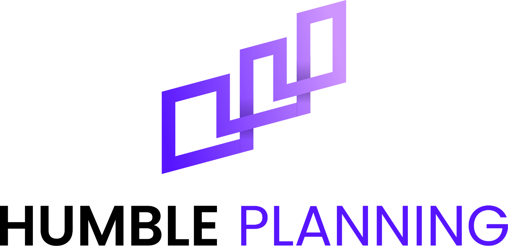
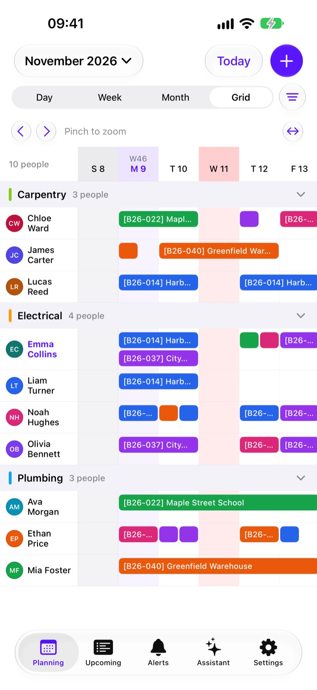
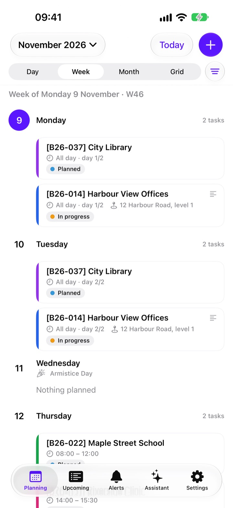
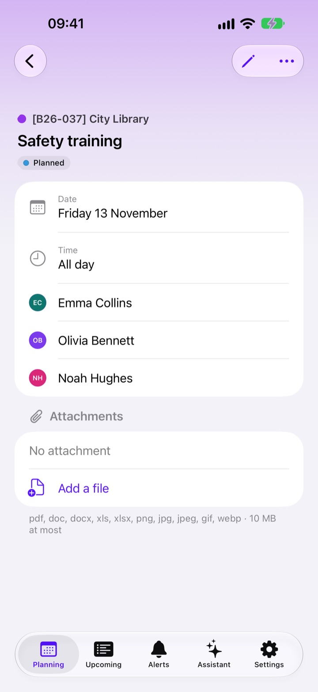
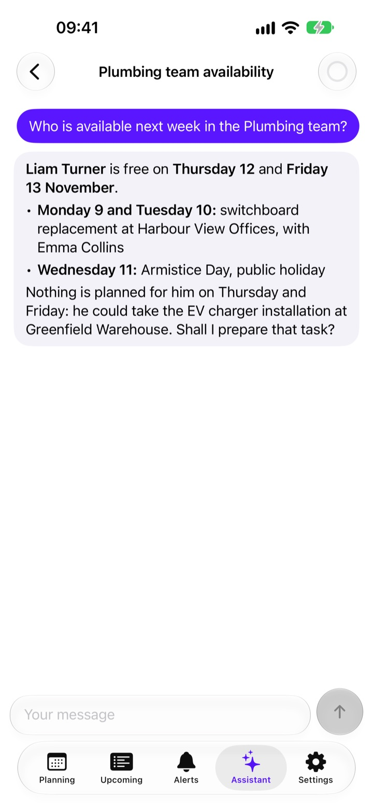
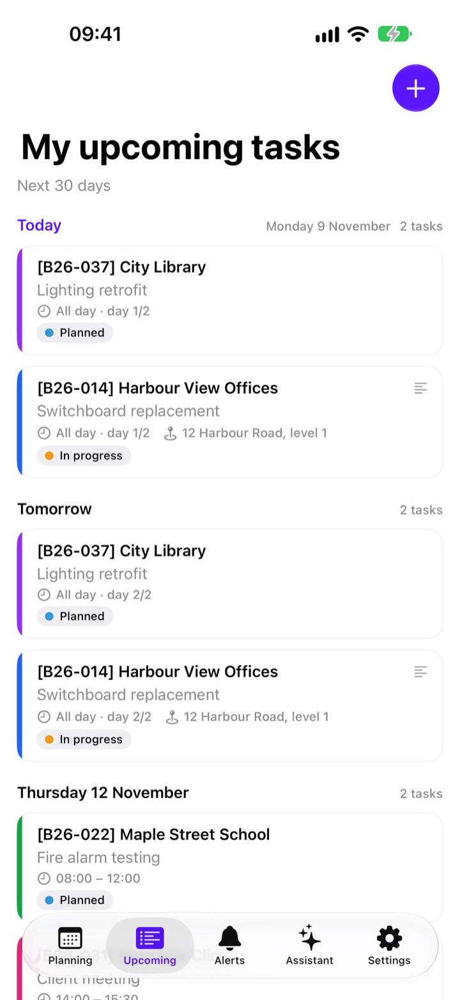
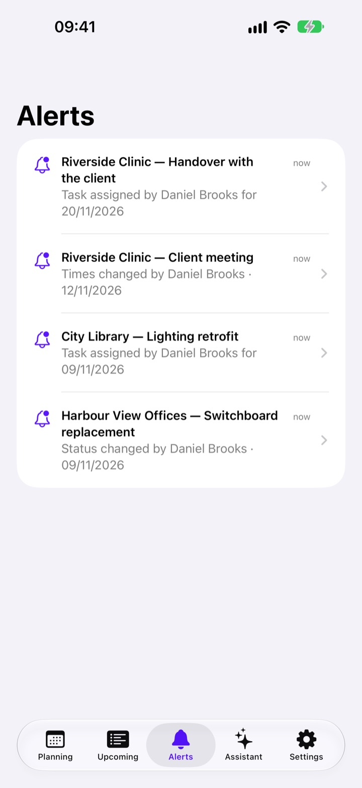
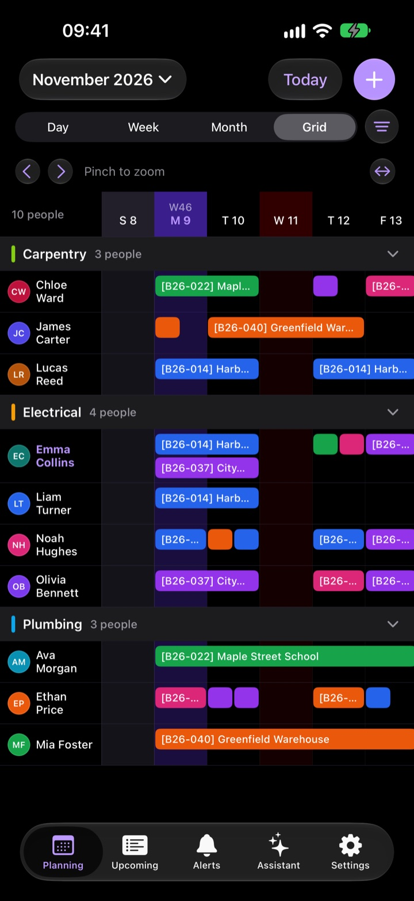
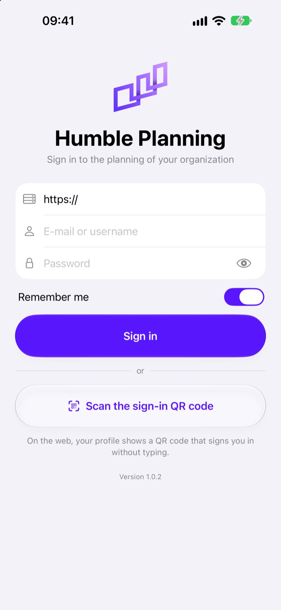

<p align="center">
  <a href="https://humbleplanning.com/">
    <picture>
      <source media="(prefers-color-scheme: dark)" srcset="docs/branding/logo-dark.png">
      
    </picture>
  </a>
</p>

<h3 align="center">Your team's schedule, in your pocket.</h3>

<p align="center">
  The native iOS app of <a href="https://github.com/Malfhas/HumblePlanning">Humble Planning</a>, the open-source scheduling application for field teams.<br>
  It connects to your own Humble Planning server: your data never goes anywhere else.
</p>

<p align="center">
  <a href="https://humbleplanning.com/"><strong>Website</strong></a> ·
  <a href="https://github.com/Malfhas/HumblePlanning"><strong>Server</strong></a> ·
  <a href="https://github.com/Malfhas/HumblePlanning-iOS/releases/latest"><strong>Download</strong></a> ·
  <a href="#installing"><strong>Installing</strong></a> ·
  <a href="https://github.com/Malfhas/HumblePlanning-Android"><strong>Android app</strong></a> ·
  <a href="CHANGELOG.md"><strong>Changelog</strong></a>
</p>

<p align="center">
  <a href="LICENSE"></a>
  <a href="https://github.com/Malfhas/HumblePlanning-iOS/releases/latest"></a>
  
  
  
</p>

<p align="center"><sub>A project by <a href="https://indumia.com/"><strong>Indumia</strong></a></sub></p>

---

<p align="center">
  <a href="#a-quick-tour">Tour</a> ·
  <a href="#features">Features</a> ·
  <a href="#installing">Installing</a> ·
  <a href="#connecting-to-your-server">Server</a> ·
  <a href="#development">Development</a> ·
  <a href="#contributing">Contributing</a> ·
  <a href="#license">License</a>
</p>

## A quick tour

<table>
  <tr>
    <td width="25%" valign="top">
      <a href="docs/screenshots/grid.jpg"></a>
      <p><strong>The team grid.</strong> Everyone on one schedule, team by team, like on the web: pinch to zoom, tap a task to open it, tap an empty day to plan someone.</p>
    </td>
    <td width="25%" valign="top">
      <a href="docs/screenshots/week.jpg"></a>
      <p><strong>Day, week and month.</strong> Your own tasks or anyone's, with public holidays, half days, statuses and places.</p>
    </td>
    <td width="25%" valign="top">
      <a href="docs/screenshots/task.jpg"></a>
      <p><strong>Every detail of a task.</strong> Dates, people, place, notes and attachments; edit it when your role allows it.</p>
    </td>
    <td width="25%" valign="top">
      <a href="docs/screenshots/assistant.jpg"></a>
      <p><strong>The AI assistant.</strong> Ask about the schedule in plain language. Any change it prepares waits for your approval.</p>
    </td>
  </tr>
  <tr>
    <td width="25%" valign="top">
      <a href="docs/screenshots/upcoming.jpg"></a>
      <p><strong>What's next.</strong> Your tasks of the next 30 days, readable offline.</p>
    </td>
    <td width="25%" valign="top">
      <a href="docs/screenshots/alerts.jpg"></a>
      <p><strong>Alerts.</strong> Told when someone changes one of your tasks, also in the background when iOS allows it.</p>
    </td>
    <td width="25%" valign="top">
      <a href="docs/screenshots/grid-dark.jpg"></a>
      <p><strong>Light and dark.</strong> Follows the iPhone, or your choice. On iPad, the same app on the large screen.</p>
    </td>
    <td width="25%" valign="top">
      <a href="docs/screenshots/sign-in.jpg"></a>
      <p><strong>Your server, your account.</strong> Sign in with your password and second factor, or scan the QR code of your web profile.</p>
    </td>
  </tr>
</table>

<p><sub>The screenshots use invented people and worksites. The app is available in English, French, Spanish and German.</sub></p>

## Features

The same features as the [Android app](https://github.com/Malfhas/HumblePlanning-Android), with the design of iOS 26 (Liquid Glass) on iPhone and iPad.

| Area | Highlights |
| --- | --- |
| **Planning** | Day, week and month views, and a team grid like the web schedule (pinch to zoom, collapsible teams); filters by person, team, project and status; public holidays; live updates as your team changes the schedule |
| **Tasks** | Create and edit tasks with several people, half days or hours, recurrence, places, resources, notes and attachments; locked tasks stay read-only |
| **Alerts** | Alerts when someone changes one of your tasks, which each user can turn off; reminders before a task starts |
| **AI assistant** | The assistant of your server, with its model and permissions; every change waits for your approval; the gauge of your monthly quota |
| **Offline** | Your own tasks stay readable without a network, encrypted on the device |
| **Sign-in** | Password, second factor, or the QR code of the web profile (the Camera app opens it too); sessions listed and revocable from the web and from the app |
| **Security** | HTTPS only, the session in the Keychain of the device, data encrypted with a key that never leaves it and excluded from backups, the server's permissions on every request |
| **Devices** | iPhone and iPad, light and dark, English, French, Spanish and German (the language of the app is chosen in the iOS settings) |

## Connecting to your server

The app needs a [Humble Planning](https://github.com/Malfhas/HumblePlanning) server that includes the mobile API (`/api/mobile`) and accepts iOS devices. Ask your administrator for its address, or sign in by scanning the QR code shown in your web profile.

The server decides what each account may do: the app follows the same permissions as the web, and a role needs the "Use the mobile app" permission. Administrators set the options under *Settings → General → Mobile app*: sign-in, QR codes, alerts, the minimum app version and the pages an outdated app opens to update.

**Push notifications.** Not yet on iOS: they need Apple's push service, which comes with the App Store version, through the push relay of the server (`deploy/push-relay`). Until then, the app reads its alerts when it opens and in the background, when iOS gives it the time.

## Installing

The app is on its way to the App Store. Until then, each [release](https://github.com/Malfhas/HumblePlanning-iOS/releases) includes an unsigned build for testers, `humbleplanning-<version>-unsigned.ipa`, with its SHA-256 checksum. iOS only installs it once it is signed with your own Apple ID, by a side-loading tool such as [AltStore](https://altstore.io/) or [SideStore](https://sidestore.io/); with a free Apple ID, the signature lasts 7 days and the tool renews it.

You can also run the app on your iPhone from Xcode (see [Development](#development)): connect the iPhone, select your Apple ID as the team of the HumblePlanning target (a free "Personal Team" will do, with a bundle identifier of your own, for example `com.example.humbleplanning`), turn on Developer Mode on the iPhone (Settings > Privacy & Security), then Product > Run.

## Development

Requirements: a Mac with Xcode 26 or later (the iOS platform installed), and Node.js for the texts and the icon.

```bash
open HumblePlanning.xcodeproj                      # or build from the command line:
xcodebuild -project HumblePlanning.xcodeproj -scheme HumblePlanning \
  -destination 'platform=iOS Simulator,name=iPhone 17' build
cd Packages/HumbleCore && swift test               # the logic of the app, on the Mac
node tools/textes.mjs                              # texts → HumblePlanning/Resources/*.xcstrings
node tools/generate-logo.mjs                       # the icon and the logo
```

Debug builds may reach a test server in clear text on the Mac or the local network (`http://localhost:3100`, `http://192.168.x.x:3000`); release builds are HTTPS only.

- `Packages/HumbleCore`: everything that does not draw, in a Swift package tested with Swift Testing — API, session, permissions, sync and offline copy, real time (Socket.IO over `URLSessionWebSocketTask`), assistant stream, Markdown, the layout of the team grid, formats, reminders.
- `HumblePlanning/`: the SwiftUI app, one folder per screen under `Features/`.
- `tools/`: texts, icon, interface tests, App Store screenshots, the unsigned `.ipa` of the releases.

No third-party dependency.

### Tests

| Level | Command | What it covers |
| --- | --- | --- |
| Unit | `cd Packages/HumbleCore && swift test` | API, permissions, sync, real time, assistant stream, formats, grid layout |
| Interface | `tools/ui-tests.sh [simulator] [-only-testing:…]` | The app on a simulator, against a real server: sign-in, planning, tasks, assistant, permissions, accessibility, iPad |
| Screenshots | `tools/screenshots.sh` | The App Store screenshots, iPhone 6.9" and iPad 13", in English and French |

The interface tests use the disposable test server of the Android repository (`tools/test-server`: Docker, data in memory, stand-ins for the AI provider and push), filled with its invented company:

```bash
HP_SERVER_SRC=../HumblePlanning HP_ANDROID_REPO=../HumblePlanning-Android tools/ui-tests.sh "iPhone 17"
```

The server only listens on the Mac; debug builds reach it in clear text at `http://localhost:3100`. `tools/build-ipa.sh` builds the unsigned `.ipa` attached to the releases (see [docs/RELEASING.md](docs/RELEASING.md)).

## Contributing

Bug reports, ideas, translations and pull requests are welcome. Read [CONTRIBUTING.md](CONTRIBUTING.md) to set up the project and learn what is checked before a change is merged. Commits are signed off under the [Developer Certificate of Origin](DCO) (`git commit -s`): you keep the copyright of your contribution. Questions and ideas go to the [Discussions](https://github.com/Malfhas/HumblePlanning/discussions) of the main repository. Everyone taking part follows the [Code of Conduct](CODE_OF_CONDUCT.md).

If Humble Planning is useful to you, you can support its development through [GitHub Sponsors](https://github.com/sponsors/Malfhas).

## Security

Please do not report security vulnerabilities in public issues: follow the [security policy](SECURITY.md).

## AI-assisted development

Humble Planning is developed with the help of AI coding assistants. They are tools in the hands of the maintainer: the product decisions, the architecture and the review of every change remain human, and all code goes through the same checks (unit tests, builds, generated translations) before it is merged. AI-assisted contributions are welcome under the same rules: see [CONTRIBUTING.md](CONTRIBUTING.md#ai-assisted-contributions).

## License

Humble Planning for iOS is free software, distributed under the **GNU Affero General Public License v3.0 or later** (`AGPL-3.0-or-later`), like the server and the Android app, with an [additional permission](LICENSE-EXCEPTION.md) that allows its distribution through the App Store. The full text of the license is in the [LICENSE](LICENSE) file.

## Credits

- Humble Planning is designed, built and maintained by **[Indumia](https://indumia.com/)**. Learn more at [humbleplanning.com](https://humbleplanning.com/).
- The privacy policy of the app is in [docs/PRIVACY.md](docs/PRIVACY.md).
